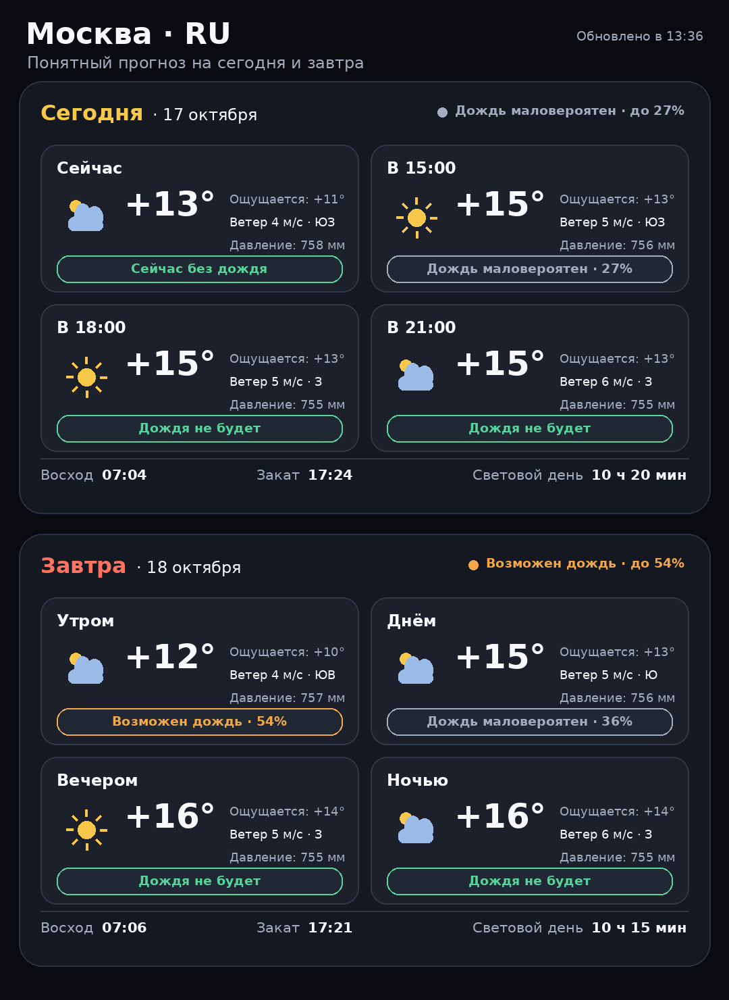

<p align="center">
  
</p>

<h1 align="center">SkyPulse — Погода и воздух</h1>

<p align="center">
  Премиальный Telegram-бот с текущей погодой, прогнозом дождя,
  качеством воздуха и мобильными PNG-карточками.
</p>

<p align="center">
  <strong>Версия 2.0.2</strong> · Python · OpenWeather · pyTelegramBotAPI
</p>

## Возможности

- текущая погода для городов по всему миру;
- поиск города с выбором страны и региона;
- прогноз на пять дней;
- понятный статус дождя: «без дождя», «возможен» или «ожидается»;
- качество воздуха с быстрым параллельным запросом;
- сравнение погоды в двух городах;
- работа с геолокацией Telegram;
- погодные уведомления;
- премиальная мобильная карточка на сегодня и завтра;
- встроенные кириллические шрифты — карточка одинаково выглядит на Windows и Linux;
- короткие сетевые тайм-ауты и журналирование ошибок;
- постоянная работа через `systemd` с автоматическим перезапуском.

## Интерфейс прогноза

<p align="center">
  
</p>

Карточка показывает ближайшие доступные периоды, температуру, ощущаемую
температуру, ветер, давление, вероятность дождя, восход, закат и длину дня.

## Быстрый запуск

Требуется Python 3.10 или новее.

```bash
python -m venv venv
```

Windows PowerShell:

```powershell
venv\Scripts\Activate.ps1
python -m pip install -r requirements.txt
Copy-Item .env.example .env
python bot.py
```

Linux:

```bash
source venv/bin/activate
python -m pip install -r requirements.txt
cp .env.example .env
python bot.py
```

## Настройка

Заполните `.env`:

```env
BOT_TOKEN=your_telegram_token
OW_API_KEY=your_openweather_key
```

- `BOT_TOKEN` создаётся через BotFather.
- `OW_API_KEY` выдаётся OpenWeather.
- Старое имя переменной `API_KEY` также поддерживается.

Файл `.env` исключён из Git и не должен публиковаться.

## Превью без Telegram

```bash
python preview_weather_card.py
```

Команда создаст локальный файл `weather_card_preview.png` без API-ключей.

## Работа 24/7 через systemd

Скопируйте проект в `/opt/weather-bot`, создайте пользователя `weatherbot` и
установите unit-файл:

```bash
sudo cp deploy/weather-bot.service /etc/systemd/system/weather-bot.service
sudo systemctl daemon-reload
sudo systemctl enable --now weather-bot
sudo systemctl status weather-bot
```

Просмотр журнала:

```bash
journalctl -u weather-bot -n 100 --no-pager
```

## Проверка проекта

```bash
python -m pip install -r requirements-dev.txt
python -m py_compile bot.py weather_app.py weather_card.py storage.py
pytest -q
```

## Структура

```text
.
├── bot.py                       Telegram-интерфейс и обработчики
├── weather_app.py               Клиент OpenWeather и анализ воздуха
├── weather_card.py              Рендер премиальной PNG-карточки
├── storage.py                   Локальное хранение настроек
├── preview_weather_card.py      Автономное создание превью
├── assets/
│   ├── branding/                Аватар SkyPulse
│   └── fonts/                   Встроенные шрифты и лицензия
├── docs/                        Изображения для документации
├── deploy/                      systemd-конфигурация
└── tests/                       Автоматические тесты
```

## Безопасность данных

Репозиторий не содержит токенов, API-ключей, `.env` и пользовательского файла
`User_Data.json`. Перед публикацией собственной сборки всегда проверяйте
изменения командой `git status`.

